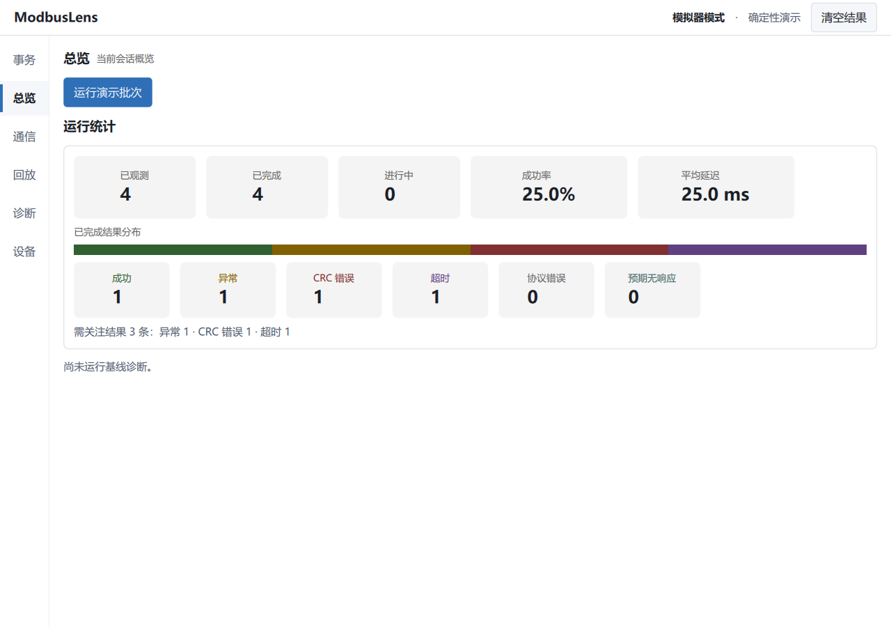
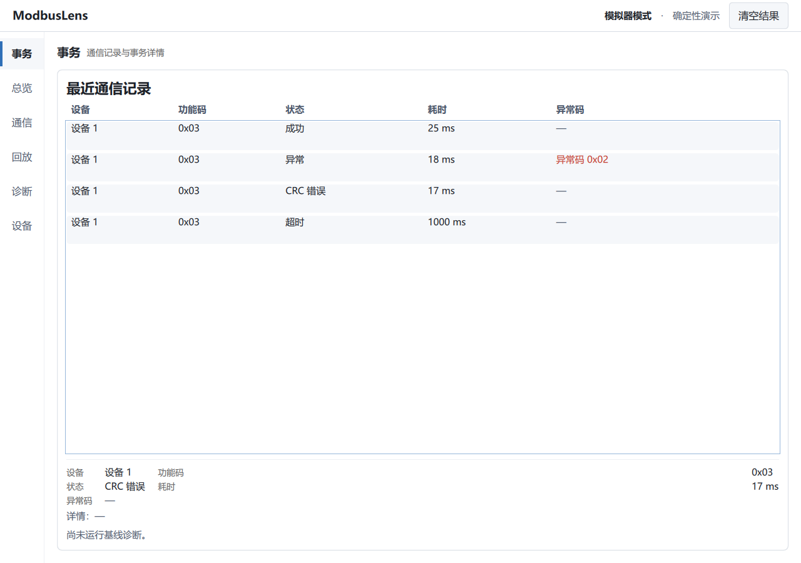
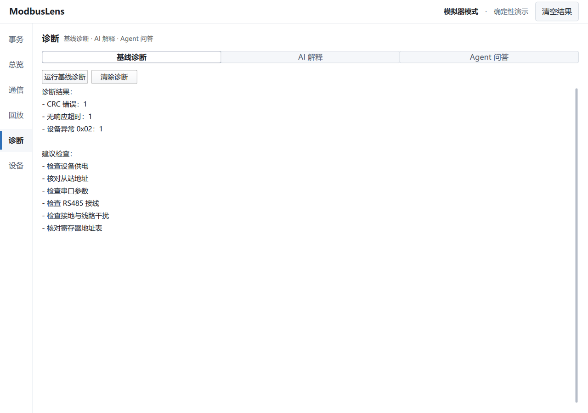
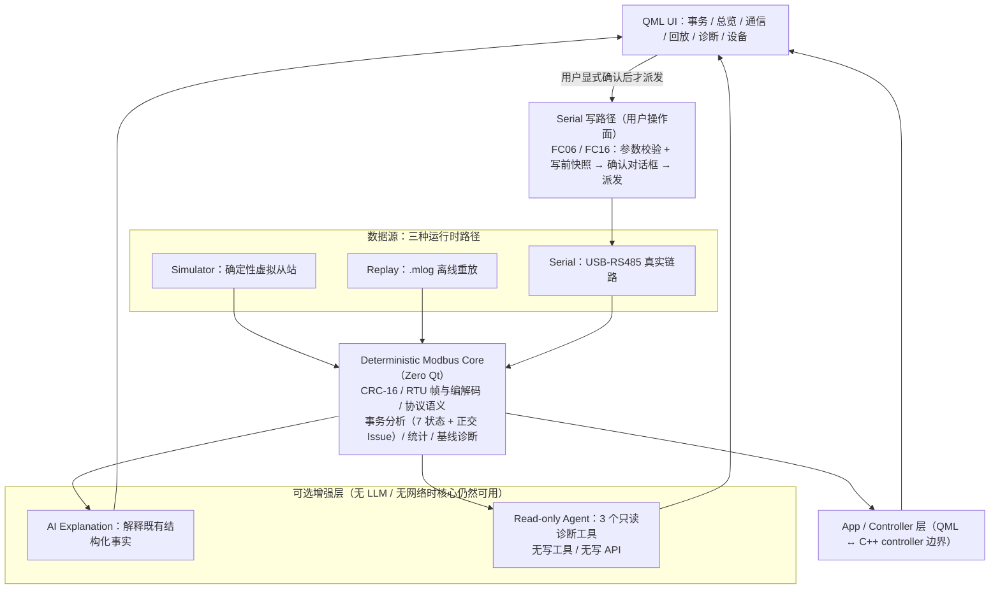

# ModbusLens

**C++20 / Qt6（Quick/QML）** 的 **Modbus RTU 通信分析与故障诊断桌面工具**：把难以阅读的原始串口通信，转成可复查、可解释的**事务（Transaction）→ 统计 → 诊断**证据链；Simulator / Replay / Serial 三种数据源共享同一套**确定性协议分析核心**，AI 解释与只读 Agent 只是其上的可选增强。



> 核心原则：**AI is interpreter, not detector**——CRC 正确性、TransactionStatus、Timeout、异常码、统计与延迟全部由 deterministic Core 决定；LLM 只解释既有事实，不产生协议事实，也不是运行核心功能的必要条件。

---

## 1. 它解决什么问题

Modbus RTU 现场故障（无响应、CRC 错误、异常码、字节序/超时）很难从原始字节流里快速定位。ModbusLens 提供：

- 一条**可重复、口径一致**的分析管线：同一批通信，在 Simulator 生成、`.mlog` 回放与真实串口三种来源下产生**相同结构**的分析结果；
- **确定性规则诊断**：只说"观察到什么 + 建议检查什么"，不宣称物理根因；无需 API Key、无需网络；
- （可选）在确定性事实之上叠加**自然语言解释**与**只读 Agent 问答**，用于加速理解，而不是替代协议分析。

**不是**：完整 SCADA、PLC 平台、完整 Modbus 实现、可自主控制设备的 Agent，也不是经过真实硬件验证产线软件。

## 2. 核心亮点

- **Pure C++ 协议核心（Zero Qt）**：CRC-16/MODBUS（按位实现 + 规范向量对拍）、RTU 帧模型与编解码、FC03 语义解码器；核心零 Qt、零网络、零 LLM，可独立单元测试与复用。
- **统一事务模型**：每笔事务归一为 **7 类状态**（Pending / Success / Exception / CrcError / Timeout / ProtocolError / ExpectedNoResponse），并正交保留 **13 类结构化 Issue**（9 响应侧 + 4 请求侧）。
- **三模式同一口径**：Simulator 黄金批次与 `demo_v1.mlog` 回放的统计快照严格相等，有自动化测试锁定。
- **FC03 读 + FC06 / Function 0x10 支持**：读路径为一等公民；写路径（FC06/0x10）既被 **Replay 被动分析**，也提供 **Serial 用户确认式主动下发**（见 §6 安全边界）。
- **设备档案 + 手册智能**：手册导入（PDF/DOCX/TXT）→ AI 提取候选 → 人工审核 → **引用校验式手册问答**（回答必须附带可本地校验的引用块）。
- **发布工程**：candidate 契约（从零重建 + 逐文件 SHA-256 manifest）、fail-fast 打包器、deployment 门；v2.0.0 便携包已公开发布并做公开资产独立校验。

## 3. 产品导览

**事务页**——通信记录与事务明细：设备 / 功能码 / 状态 / 耗时 / 异常码一列可见，选中行联动下方明细区：



**诊断页（Baseline，确定性）**——对同一批证据做**规则诊断**（下图是**确定性基线诊断**结果，不是 AI 生成内容）：异常计数 + 建议检查项（供电/从站地址/串口参数/接线/干扰/寄存器映射）：



> 说明：Replay 页面截图未纳入本 README 展示（保留为仓库内证据）；Serial 页面图片因当前环境无物理串口设备、无法构造一致的真实截图而未纳入（见 §8 已知限制）。

## 4. 架构



要点：

- **确定性在底层**：协议事实（CRC、状态、异常码、统计、延迟）只由 Zero-Qt Core 产生；UI、AI、Agent 都是它的**消费者**。
- **Qt 只在边界之上**：Qt 类型只允许出现在 App/Adapter 层；核心可无头测试。
- **AI 与 Agent 是可选上层**：断网、未配置 Key、移除该层时，三模式 + 基线诊断完整可用。
- **Agent 与写路径彼此隔离**：Agent 工具层没有任何写 API；设备写只可能是**用户在 UI 中显式确认后**由 Serial 路径派发（FR-AG-02 只读边界不变）。

## 5. 三种运行模式

| 模式 | 用途 | 输入 | 关键行为 |
| --- | --- | --- | --- |
| **Simulator** | 零硬件演示 / 确定性流量 / 故障注入 | 内置虚拟从站 | 一键生成 4 笔黄金批次（Success / Exception 0x02 / CRC Error / Timeout），统计可精确复述 |
| **Replay** | 历史日志离线复盘（可重复、可测试） | `.mlog` 文本日志 | 整批瞬间重析；语法错误整体失败，坏请求/不支持功能码按记录保留事实 |
| **Serial** | 真实 Modbus RTU 链路 | USB-RS485 串口（8N1，波特率可配） | FC03 读 + FC06/0x10 用户确认式写；一次一笔事务；transport error 与 Modbus Timeout 严格分离 |

> **Serial 的能力与验证边界**：写/读路径均已**实现并有自动化与 harness/seam 级验证**；但**当前环境没有真实物理 Modbus 设备的验证证据**——Serial 的可用性取决于兼容硬件与正确的串口配置，README 不声称"已在现场 PLC/设备上验证"。演示与验收的安全默认路径是 Simulator 与 Replay（零硬件）。

## 6. Serial 写操作安全边界（FC06 / FC16）

产品内置的写路径刻意做成**两步式、用户确认**，而不是"点一下就直接下发"：

```text
prepare / validate（从站与寄存器地址、数量、值域校验）
  → 读/快照当前值回显（写前快照）
  → 确认对话框（目标从站 / 地址 / 数量 / 值清单 / PDU / RTU 帧）
  → 用户点击「确认写入」
  → 经已打开的 Serial 会话派发（一次一笔事务）
```

- **连接是前提**：未连接串口时写入不可用；未通过校验时预览与写入按钮保持禁用。
- **确认与派发分离**：确认对话框出现前不产生任何下发。
- **Agent 无关**：Agent 无写工具、无写 API，模型不会自主下发设备写操作；写只能由用户操作触发。
- **验证口径**：写路径的自动化/harness 验证存在；**真实硬件写验证不在当前证据范围内**。

## 7. 技术栈

| 层 | 技术 |
| --- | --- |
| 语言 / 标准 | C++20（`CMAKE_CXX_STANDARD 20`） |
| UI | Qt 6.11.1（MinGW x64）· Qt Quick / QML + C++ controller 桥 |
| 通信 | Qt SerialPort（Serial）· Qt Network（可选 AI/Agent 的 HTTP/TLS） |
| PDF/DOCX 手册解析 | PDFium（pinned）+ libzip/zlib（static，离线物化 + 配置期 hash 断言） |
| 构建 / 测试 | CMake ≥ 3.21 + Ninja · CTest（70 个测试目标）· 手写断言 harness（零第三方测试框架） |
| 可选 AI | OpenAI-compatible Chat Completions（BYOK，环境变量配置） |
| 发布 | Windows portable ZIP（candidate 契约 + fail-fast 打包器 + deployment 门） |

## 8. Quick Start

环境要求与平台细节：[docs/ENVIRONMENT.md](docs/ENVIRONMENT.md)（Qt ≥ 6.5，本项目基线 6.11.1；CMake ≥ 3.21）。

```bash
# 构建 + 运行测试（Qt 位于系统默认位置时使用公开 preset）
cmake --preset debug
cmake --build --preset debug
ctest --preset debug

# 运行
./build/debug/modbuslens.exe        # Windows：build\debug\modbuslens.exe
```

- `--preset release` 对应 Release 构建；`debug-local` / `release-local` 为仅存在于本机、被 `.gitignore` 忽略的私有 preset（见 ENVIRONMENT.md）。
- **直接体验（无需硬件）**：启动后运行 **Simulator 演示批次**，或加载 `samples/demo_v1.mlog` 用 Replay；两者统计口径严格一致。
- **独立部署（免 Qt 开发环境）**：`scripts\deploy_windows.bat`。
- **使用已发布包**：[ Releases · v2.0.0 ](https://github.com/TheVoid2021/ModbusLens/releases/tag/v2.0.0)（`ModbusLens-2.0.0-windows-x64.zip`；SHA-256 见 Release 页与 [CHANGELOG](CHANGELOG.md)）。
- **AI 功能（可选）**：需自行配置兼容的 provider/model（环境变量）。**不配置时** Simulator / Replay / Serial、统计、基线诊断与手册导入全部照常可用。

## 9. 验证与测试

- **自动测试**：CTest **70/70 PASS**（2026-10-07 release verification snapshot，Release 配置、exit 0；数字为快照而非永恒常量）。覆盖协议/CRC/帧、事务与统计、Replay 回放矩阵、Serial 会话、写路径、规则诊断、AI 客户端（本地 fake provider，零真实网络）、Agent 工具/Runtime、UI bridge、QML smoke/navigation/geometry、独立部署 + minimal-PATH 冒烟与依赖契约。详见 [docs/04_TEST_STRATEGY.md](docs/04_TEST_STRATEGY.md)。
- **人工验收**：v2.0.0 便携包完成 H1–H8 人工验收（启动/解压/Simulator 演示/Replay 样例/三模式边界/内容泄漏检查/手册问答收回/长结果滚动）。
- **硬件边界**：串口/写路径为 harness/seam 级自动验证；**REAL MODBUS HARDWARE = NOT VERIFIED**。
- **Replay 性能（离线管线）**：10 万条混合记录中位 **70.9 ms ≈ 1.41 M records/s**，100k → 1M 近线性扩展；口径为 offline Replay / Core analysis throughput，与 RS-485 物理吞吐无关。完整方法见 [docs/10_REPLAY_PERFORMANCE_BENCHMARK.md](docs/10_REPLAY_PERFORMANCE_BENCHMARK.md)。

## 10. 演示与文档入口

- 演示脚本（3–5 分钟面试主线 + 离线 fallback）：[docs/05_DEMO_GUIDE.md](docs/05_DEMO_GUIDE.md)
- 架构与设计决策：[docs/02_ARCHITECTURE.md](docs/02_ARCHITECTURE.md)
- 测试策略与分层：[docs/04_TEST_STRATEGY.md](docs/04_TEST_STRATEGY.md)
- 当前状态（单一事实源）：[docs/PROJECT_STATUS.md](docs/PROJECT_STATUS.md)
- 任务/里程碑清单：[docs/BACKLOG.md](docs/BACKLOG.md)
- 版本记录：[CHANGELOG.md](CHANGELOG.md)
- 工程档案（任务 / Issue / ADR / 每日 devlog）：`docs/tasks/`、`docs/issues/`、`docs/adr/`、`docs/devlog/`

```text
src/      C++20 生产代码（core/ 纯逻辑 · replay/ · serial/ · ui/ QML adapter）
tests/    CTest 70 个测试目标（单元 / 组件 / 集成）
samples/  .mlog 演示与验收样本（demo_v1.mlog 为 canonical 黄金样本）
docs/     架构 · 测试策略 · 性能基准 · 任务档案 · Issue · ADR · devlog
scripts/  部署与打包工具（deploy_windows.bat · make_package.py 等）
```

## 11. 已知限制（Known Limitations）

- **真实物理硬件未验证**：当前环境没有真实 Modbus 设备的验证证据；Serial 读/写为实现完成 + harness 级验证。
- **功能码范围有意收敛**：一等支持为 FC03 读、FC06/0x10 写（主动 + 被动分析）；并非全部 Modbus 功能码。
- **无 register map / 工程单位层**：异常码 0x02 可指向"非法数据地址"并建议核对映射，但不指认具体寄存器语义。
- **未实现**：Modbus TCP、t1.5/t3.5 时序分析、UART parity/framing 明细、installer、代码签名。
- **AI/Agent 需外部配置**：无 provider/model 时该层不可用，但核心诊断与三模式不受影响；Agent 永远只读（3 个工具），无 RAG/MCP/多智能体/持久会话历史。
- **Replay 为批量重析**：无实时播放/调速；`.mlog` v1 语法保持稳定。

## 12. 版本与许可

- **当前公开版本：v2.0.0**（2026-10-07）——便携包 `ModbusLens-2.0.0-windows-x64.zip`（35,814,735 字节，SHA-256 `6db918f3…1a3a19`），已通过自动化验证与人工验收；详见 [CHANGELOG.md](CHANGELOG.md) 与 [Release 页](https://github.com/TheVoid2021/ModbusLens/releases/tag/v2.0.0)。
- **许可：尚未选择**——仓库目前未包含 LICENSE 文件；许可证由所有者后续决策（在此之前请勿假定任何开源许可）。发布包为未签名 portable ZIP。